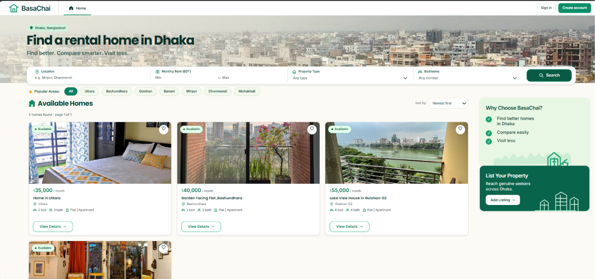
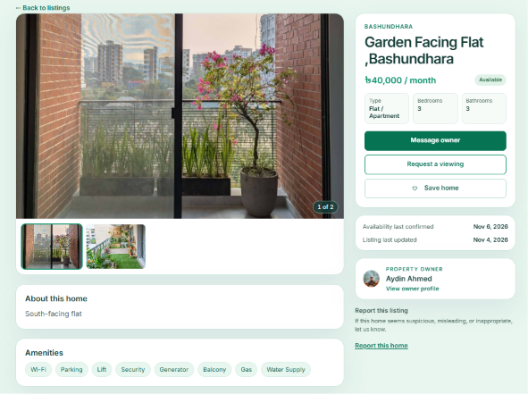
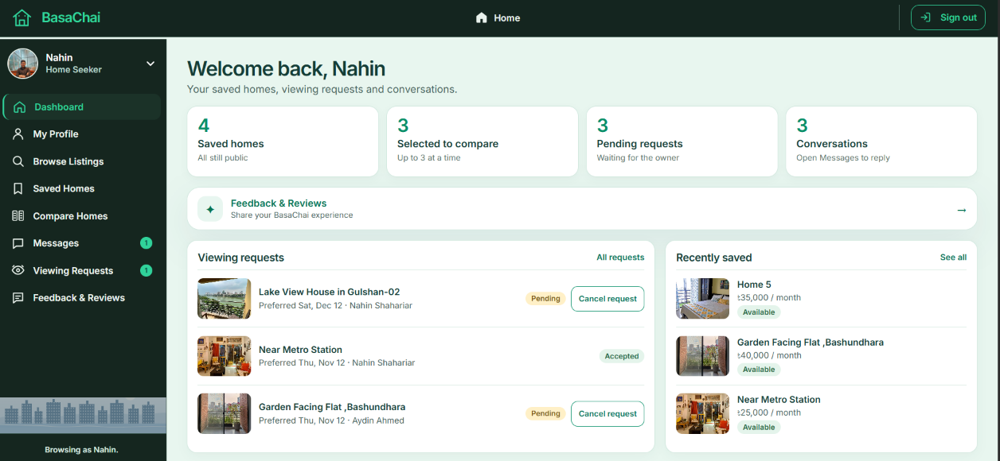
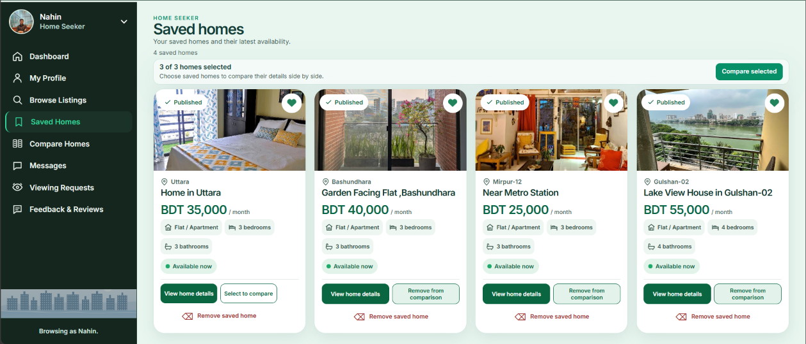
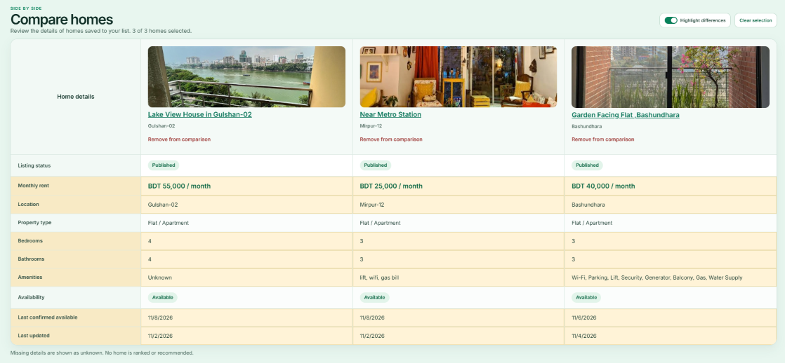
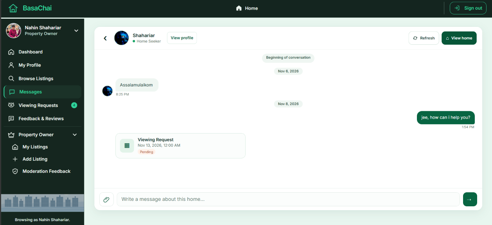
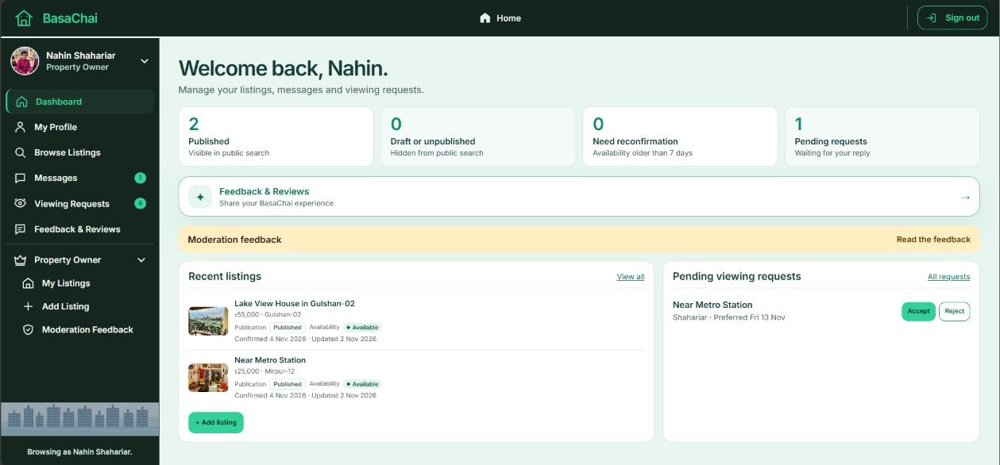
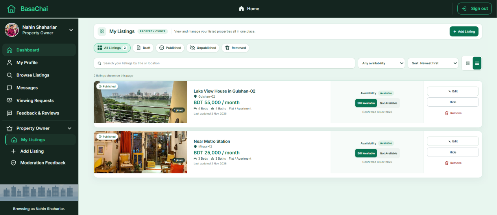
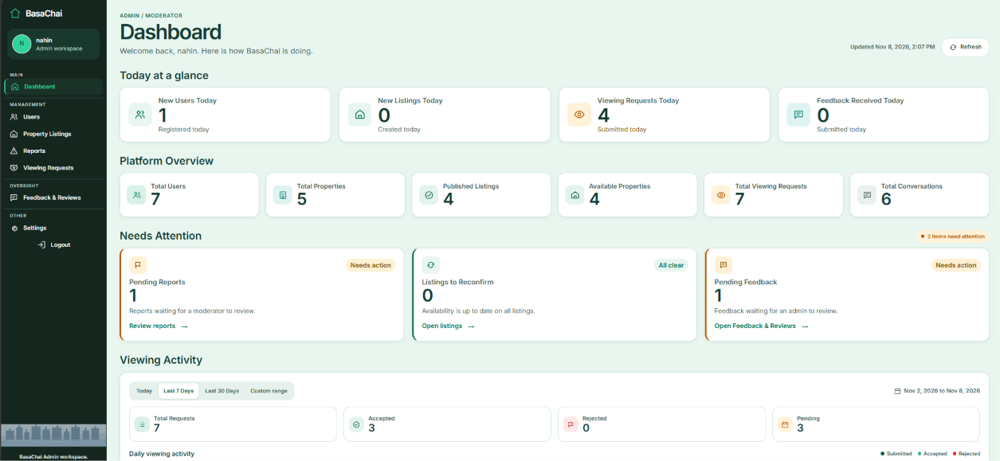

# BasaChai — Rental Housing Platform

> Find suitable homes. Compare your options. Decide which properties are worth visiting.

BasaChai is a web-based rental housing platform designed to make house hunting in Dhaka, Bangladesh, more convenient and informed. It helps home seekers discover rental properties, evaluate available options, shortlist preferred homes, and communicate with property owners—all before spending time and money on unnecessary visits.

The platform provides separate experiences for home seekers, property owners, and administrators through a React frontend and a Django REST Framework backend.

---

## Table of Contents

- [Project Overview](#project-overview)
- [Problem Statement](#problem-statement)
- [Key Features](#key-features)
- [User Roles](#user-roles)
- [Screenshots](#screenshots)
- [Technology Stack](#technology-stack)
- [System Architecture](#system-architecture)
- [Getting Started](#getting-started)
  - [Prerequisites](#prerequisites)
  - [Backend Setup](#backend-setup)
  - [Frontend Setup](#frontend-setup)
- [Environment Configuration](#environment-configuration)
  - [Backend — Render](#backend--render)
  - [Frontend — Vercel](#frontend--vercel)
- [Testing and Validation](#testing-and-validation)
- [Deployment](#deployment)
- [Project Links](#project-links)
- [Author](#author)

---

## Project Overview

Finding a suitable rental home can be time-consuming. People often need to browse multiple listings, contact different owners, compare prices and facilities, and visit properties before making a decision.

BasaChai aims to simplify this process by bringing the essential house-hunting activities into one platform.

**The core journey:**

`Find` → `Evaluate` → `Shortlist` → `Compare` → `Communicate` → `Decide` → `Visit`

The platform focuses on helping users make better-informed decisions before arranging physical visits.

---

## Problem Statement

Traditional house hunting often involves scattered information, repeated communication, and unnecessary property visits. Home seekers may struggle to compare available options, while property owners need a convenient way to manage listings and respond to interested renters.

BasaChai addresses these challenges by providing a centralized platform where seekers can explore properties, compare their choices, and communicate with owners, while owners can manage their listings and viewing requests.

---

## Key Features

### Property Discovery

- Browse publicly available rental listings.
- Search and filter properties using relevant criteria.
- View detailed property information and images.
- Explore listings without requiring an account.

### Home Seeker

- Create an account and manage a personal profile.
- Save preferred properties for later.
- Compare up to three properties side by side.
- Send messages to property owners.
- Request property viewings.
- Track viewing request statuses.
- Manage personal information and profile visibility.

### Property Owner

- Create and manage rental listings.
- Upload property images.
- Manage listing publication and availability.
- Respond to viewing requests.
- Communicate with interested home seekers.
- Manage owner profile information.

### Messaging and Communication

- Property-related conversations between seekers and owners.
- Support for message attachments.
- Private storage and authenticated attachment downloads.

### Admin and Moderation

- Admin dashboard and platform overview.
- Manage users and property listings.
- Review moderation reports and feedback.
- Manage viewing requests.

---

## User Roles

- **Home Seeker:** Discover, shortlist, compare properties, communicate with owners, and request viewings.
- **Property Owner:** Publish and manage listings, communicate with seekers, and handle viewing requests.
- **Admin / Moderator:** Oversee platform activity and manage users, listings, reports, and moderation.

> **Note:** Administrative access is controlled; public administrator registration is not available.

---

## Screenshots

*Screenshots of the running application will be added here.*

| Page | Screenshot Placeholder |
| --- | --- |
| Home / Landing Page & Property Browse |  |
| Property Details |  |
| Home Seeker Dashboard |  |
| Saved Homes |  |
| Property Comparison |  |
| Messages |  |
| Owner Dashboard |  |
| My Listings |  |
| Admin Dashboard |  |

<!-- Replace these placeholders with actual screenshots captured from the running application. -->

---

## Technology Stack

### Frontend

- **React** (Component-based UI)
- **JavaScript**
- **Vite** (Build tool and dev server)
- **CSS** (Styling)
- **React Router** (Client-side routing)

### Backend

- **Python** (Runtime)
- **Django** (Web framework)
- **Django REST Framework** (RESTful API layer)
- **Simple JWT** (Token-based authentication)

### Database and Storage

- **PostgreSQL** (Primary relational database)
- **Supabase Storage** (S3-compatible object storage for production media and private attachments)

### Authentication and Security

- JWT authentication
- HttpOnly refresh-token cookies
- CSRF protection
- CORS configuration
- Role-based access control (RBAC)
- Private message attachment storage

### Development and Deployment

- **Git and GitHub** (Version control)
- **VS Code** (Development environment)
- **Vercel** (Frontend hosting)
- **Render** (Backend hosting)
- **Neon** (PostgreSQL hosting)
- **Supabase** (Object storage)

---

## System Architecture

BasaChai follows a decoupled frontend-backend architecture:

- The React application provides the user interface and handles client-side routing.
- The frontend communicates with the Django REST Framework API through HTTP requests.
- Django handles application logic, authentication, authorization, and data processing.
- PostgreSQL stores structured application data.
- Supabase S3-compatible storage handles production media and private message attachments.

**Application flow:**

```text
React Frontend ──── HTTP / REST API ────► Django Backend ────► PostgreSQL
                                              │
                                              └────► Supabase Storage (S3 API)

---

## Getting Started

Follow these instructions to run BasaChai locally.

### Prerequisites

Make sure the following tools are installed:

- Python 3.11+
- Node.js and npm
- PostgreSQL
- Git

### Backend Setup

1. **Clone the repository:**

   ```bash
   git clone https://github.com/nahinsha/BashaChai.git
   cd BashaChai


2. **Navigate to the backend directory:**

   `cd backend`

3. **Create your local environment file:**

   `if (-not (Test-Path .env)) { Copy-Item .env.example .env }`

   Configure the database values in `.env` for your local PostgreSQL instance.

4. **Enable local environment loading:**

   `$env:BASACHAI_ENV = "development"`

5. **Create and activate a virtual environment:**

   `python -m venv .venv`

   `.\.venv\Scripts\Activate.ps1`

6. **Install backend dependencies:**

   `pip install -r requirements.txt`

7. **Apply database migrations:**

   `python manage.py migrate`

8. **Start the Django development server:**

   `python manage.py runserver`

   Backend development server: `http://127.0.0.1:8000/`


> **Note:** The local `.env` file is ignored by Git. With `DJANGO_DEBUG=true`, a temporary development secret key is generated if one is not configured. Existing shell or IDE environment values take precedence over `.env`. Production does not load this local environment file and requires an explicitly configured `DJANGO_SECRET_KEY`.

### Frontend Setup

Open a separate terminal.

1. **Navigate to the frontend directory:**

   `cd frontend`

2. **Install dependencies:**

   `npm ci`

3. **Start the Vite development server:**

   `npm run dev`

   The frontend will be available at the local URL displayed by Vite, usually: `http://localhost:5173/`

During local development, Vite proxies `/api/v1` requests to Django at `http://127.0.0.1:8000`.

---

## Environment Configuration

Keep all secret values outside the repository. Never commit `.env` files, database passwords, secret keys, or storage credentials.

### Backend — Render

Configure the following environment variables in the Render service settings.

#### Required Production Variables

| Variable | Purpose |
| --- | --- |
| `DJANGO_SECRET_KEY` | Django production secret key |
| `DJANGO_ALLOWED_HOSTS` | Comma-separated backend hostnames |
| `DATABASE_URL` | PostgreSQL connection URL |
| `SUPABASE_S3_ACCESS_KEY_ID` | Storage access key ID |
| `SUPABASE_S3_SECRET_ACCESS_KEY` | Storage secret access key |
| `SUPABASE_S3_ENDPOINT_URL` | HTTPS S3-compatible storage endpoint |
| `PASSWORD_RESET_FRONTEND_URL` | Frontend origin for password-reset links |
| `CORS_ALLOWED_ORIGINS` | Exact allowed frontend origins |

- Set `DJANGO_DEBUG=false` in production (it defaults to `false`).
- If `CSRF_TRUSTED_ORIGINS` is configured separately, provide the exact HTTPS frontend origins. Otherwise, it defaults to `CORS_ALLOWED_ORIGINS`.

#### Database Alternative

Instead of `DATABASE_URL`, the backend can use individual database settings:

- `DB_NAME`
- `DB_USER`
- `DB_PASSWORD`
- `DB_HOST`
- `DB_PORT`

#### Email Configuration

For SMTP-based password-reset email delivery, configure:

- `EMAIL_HOST`
- `EMAIL_PORT`
- `EMAIL_HOST_USER`
- `EMAIL_HOST_PASSWORD`
- `EMAIL_USE_TLS` or `EMAIL_USE_SSL` (enable at most one)
- `DEFAULT_FROM_EMAIL`

The default production email backend is Django SMTP. A different Django-compatible email backend can be configured using `EMAIL_BACKEND`.

#### Optional Backend Settings

| Variable | Purpose |
| --- | --- |
| `JWT_SIGNING_KEY` | JWT signing key; defaults to `DJANGO_SECRET_KEY` |
| `JWT_ACCESS_LIFETIME_MINUTES` | Access-token lifetime |
| `JWT_REFRESH_LIFETIME_DAYS` | Refresh-token lifetime |
| `JWT_REFRESH_COOKIE_SAMESITE` | Refresh-cookie SameSite policy |
| `DJANGO_SECURE_HSTS_SECONDS` | HSTS duration |
| `DJANGO_SECURE_HSTS_INCLUDE_SUBDOMAINS` | Include subdomains in HSTS |
| `DJANGO_SECURE_HSTS_PRELOAD` | Enable HSTS preload |
| `EMAIL_BACKEND` | Django email backend |
| `EMAIL_TIMEOUT` | Email connection timeout |
| `MESSAGE_ATTACHMENT_ROOT` | Local message attachment storage location |

Production refresh cookies use the `Secure` attribute. Cross-site cookie behavior depends on browser privacy policies and the configured SameSite setting. Render provides the `PORT` environment variable automatically.

### Frontend — Vercel

Configure the following variable in Vercel project settings:

| Variable | Purpose |
| --- | --- |
| `VITE_API_ROOT` | Backend API base URL, including `/api/v1` |

**Example:**

```env
VITE_API_ROOT=https://your-backend-domain/api/v1

## Deployment

The deployment configuration uses the following services:

- **Frontend:** Vercel
- **Backend:** Render
- **PostgreSQL Database:** Neon
- **Object Storage:** Supabase

Production environment variables must be configured in the respective hosting platforms.

---

## Project Links

- **Live Application:** [BasaChai](https://basha-chai-xi.vercel.app/)
- **Source Code Repository:** [GitHub Repository](https://github.com/nahinsha/BashaChai)

> **Note:** The live application is intended for demonstration and testing. Availability and performance may vary depending on free-tier platform quotas.

---

## Author

- **Md Shahariar Nahin**
  - GitHub: [@nahinsha](https://github.com/nahinsha)
  - Repository: [nahinsha/BashaChai](https://github.com/nahinsha/BashaChai)
  - Email: [nahinshahariar27@gmail.com](mailto:nahinshahariar27@gmail.com)